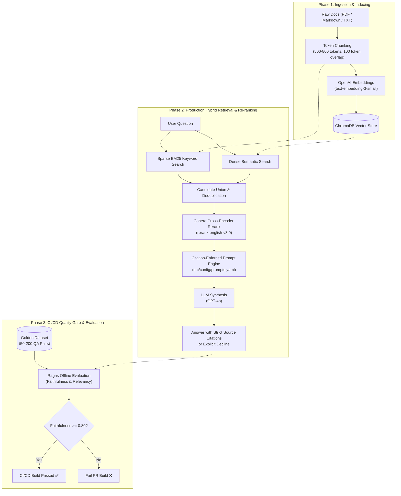

# 🚀 Production-Grade Retrieval-Augmented Generation (RAG) System

[](https://github.com/your-username/production-rag-system/actions)
[](https://www.python.org/)
[](https://opensource.org/licenses/MIT)
[](https://www.langchain.com/)
[](https://www.trychroma.com/)
[](https://cohere.com/)
[](https://docs.ragas.io/)

An enterprise-ready, domain-specific **'Ask-My-Doc'** Retrieval-Augmented Generation architecture designed for zero-hallucination compliance, high retrieval precision, and automated CI/CD quality enforcement.

---

## 🏛️ System Architecture



---

## 🌟 Key Features

### Phase 1: Fundamentals
- **Token-Aware Chunking**: Uses `RecursiveCharacterTextSplitter.from_tiktoken_encoder` configured for **500–800 tokens with a 100-token sliding overlap** (`cl100k_base`), guaranteeing contextual boundary integrity.
- **Heterogeneous Parsers**: Native ingestion for `.pdf`, `.md`, and `.txt` documents.
- **Persistent Vector Store**: ChromaDB integration backed by OpenAI `text-embedding-3-small`.

### Phase 2: Production Quality
- **Hybrid Retrieval**: Combines BM25 sparse keyword matching with dense vector similarity to solve the "vocabulary mismatch" problem.
- **Cross-Encoder Re-Ranking**: Reranks top-$k$ candidates with Cohere's `rerank-english-v3.0` cross-encoder for deep token-level interaction.
- **Citation Enforcement**: Strictly demands source file and page citations; explicitly instructs the model to refuse answering if the context is insufficient.
- **Versioned Prompt Config**: Prompts are externalized and version-controlled via `src/config/prompts.yaml`.

### Phase 3: CI/CD Quality Gate
- **Offline Evaluation with Ragas**: Evaluates faithfulness and answer relevancy against a golden dataset (`tests/golden_dataset.json`).
- **Automated Pull Request Blocking**: GitHub Actions workflow fails PR builds when faithfulness scores drop below the configured threshold (default: `0.80`).

---

## 📁 Repository Structure

```text
.
├── .github/
│   ├── workflows/
│   │   └── ci.yml                     # Multi-matrix CI & Ragas quality gate
│   ├── ISSUE_TEMPLATE/
│   │   ├── bug_report.md              # Structured bug report template
│   │   └── feature_request.md         # Feature request template
│   └── pull_request_template.md       # PR checklist and evaluation criteria
├── data/
│   └── sample_docs/
│       └── enterprise_rag_specification.md  # Sample ingestion corpus
├── src/
│   ├── __init__.py
│   ├── config/
│   │   ├── __init__.py
│   │   └── prompts.yaml               # Versioned LLM prompts with citation rules
│   ├── ingestion/
│   │   ├── __init__.py
│   │   └── document_processor.py      # Token-bounded document chunking
│   ├── retrieval/
│   │   ├── __init__.py
│   │   ├── vector_store.py            # ChromaDB vector store wrapper
│   │   └── hybrid_search.py           # BM25 + Vector + Cohere cross-encoder rerank
│   ├── generation/
│   │   ├── __init__.py
│   │   └── llm_chain.py               # LCEL generation pipeline with citations
│   └── evaluation/
│       ├── __init__.py
│       └── evaluate.py                # Ragas offline evaluation script
├── tests/
│   ├── __init__.py
│   ├── golden_dataset.json            # Curated QA evaluation pairs
│   ├── test_document_processor.py     # Ingestion & chunking unit tests
│   ├── test_hybrid_search.py          # BM25 & reranker unit tests
│   └── test_citation_prompt.py        # Prompt & citation formatting tests
├── .env.example                       # Environment template
├── .gitignore                         # Python, OS, virtualenv & database ignores
├── CONTRIBUTING.md                    # Contributor guide
├── LICENSE                            # MIT License
├── main.py                            # Unified CLI entrypoint
├── pyproject.toml                     # Modern packaging & pytest config
├── requirements.txt                   # Production dependencies
└── README.md                          # Project documentation
```

---

## ⚡ Quickstart Guide

### 1. Clone & Set Up Environment

```bash
git clone https://github.com/your-username/production-rag-system.git
cd production-rag-system

# Create virtual environment
python3 -m venv .venv
source .venv/bin/activate

# Install dependencies
pip install --upgrade pip
pip install -r requirements.txt
```

### 2. Configure Credentials

Copy the environment template and set your API keys:

```bash
cp .env.example .env
```

Edit `.env`:
```ini
OPENAI_API_KEY=sk-...
COHERE_API_KEY=...
CHROMA_PERSIST_DIR=./chroma_db
RAGAS_FAITHFULNESS_THRESHOLD=0.80
```

---

## 🖥️ CLI Usage

The repository provides a single CLI entrypoint (`main.py`):

### Ingest Documents (Phase 1)
Parse, chunk, and index documents from `data/sample_docs`:
```bash
python main.py ingest --dir data/sample_docs --chunk-size 800 --chunk-overlap 100
```

### Query Pipeline (Phase 2)

**Basic Semantic Search:**
```bash
python main.py query "What chunk overlap size is required?"
```

**Production Hybrid Search with Cohere Cross-Encoder Reranking:**
```bash
python main.py query "Why combine BM25 and vector search?" --hybrid --top-k 10 --rerank-top-k 3
```

**Testing Anti-Hallucination & Refusal:**
```bash
python main.py query "What is the capital of Mars?"
# Output: "I cannot answer this question based on the provided context."
```

### Run Evaluation Gate (Phase 3)
Run offline Ragas evaluation against `tests/golden_dataset.json`:
```bash
python main.py evaluate --threshold 0.80
```

---

## 🧪 Testing & CI/CD Guardrails

### Local Unit Testing
Unit tests run locally with mock keys without needing live API billing:
```bash
pytest -v
```

### GitHub Actions CI Workflow
On every Pull Request to `main`, GitHub Actions automatically:
1. Validates code syntax and executes unit tests across Python 3.10 and 3.11.
2. Ingests the sample documentation corpus.
3. Executes `src/evaluation/evaluate.py` with Ragas.
4. **Fails the build** if the mean faithfulness score falls below `0.80`.

---

## 📜 License
Distributed under the [MIT License](LICENSE).
